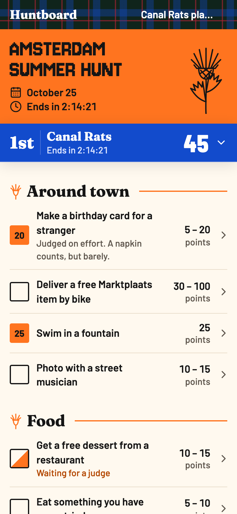
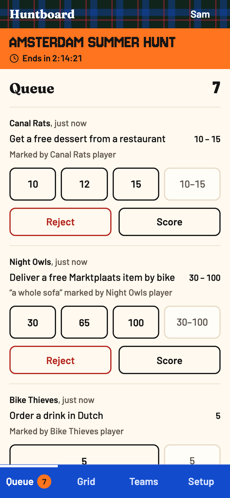
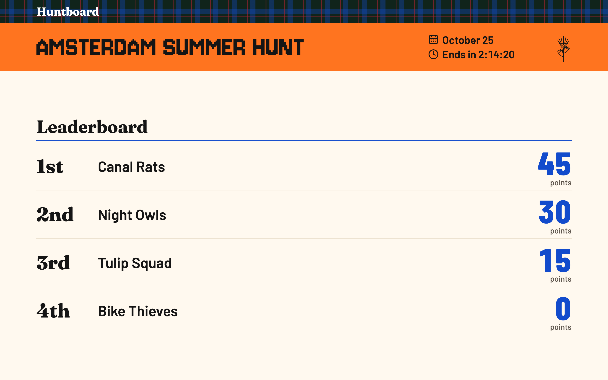

# Huntboard

A live scoreboard for team scavenger hunts. Teams check off challenges from their phones, organisers judge and award points, and everyone watches one shared leaderboard.

Only game creators have accounts. Each team joins through its own secret link, so teams see only their own progress and the totals of everyone else. Judges share the admin link, and spectators use the scoreboard link.

| Team | Judge |
|---|---|
|  |  |



> This ran a real game with 50 players fine, and should scale to thousands of concurrent players. To stay within the Cloudflare free tier, keep it to about 70 players a day in 5-hour games (see [Free-tier budget](#free-tier-budget)).

- [Design](DESIGN.md): visual and interaction rules for every screen
- [Challenge format](docs/challenge-format.md): how organisers paste in their challenge list

## How a game works

| Role | How they get in | What they can do |
|---|---|---|
| Creator | An account: their email address | Create games at `/new` and find them again on My games (`/games`). They land on the new game's admin page |
| Admin | The admin link | Edit the game, challenges and teams, judge claims, add adjustments, record arrivals, rotate links |
| Player | Their team's link | See all challenges, mark them done with an optional note and photo or video, undo a pending claim, rename the team |
| Spectator | The scoreboard link | See team names, members and totals |

A creator signs in with their email address. The email holds a link and a six-digit code: the link works in any browser, and the code works in the tab that asked for it, for phones that open links inside the mail app. The first sign-in for an address creates the account and asks only for a display name. A game made before accounts has no owner: a signed-in creator who opens its admin link adds it to their games from the Setup tab.

Players and admins type a nickname on first visit. It is kept in the browser and only shows who marked or judged something. It is not an account.

- **Links are the access model.** Each link holds a 128-bit random token. Anyone with a team link is on that team, and several judges share one admin link. A leaked link is rotated from Setup, and the old one stops working at once. Setup also shows each link as a QR code, and the big-screen scoreboard shows a QR code of its own link for spectators.
- **Claims take two steps.** A team marks a challenge done, and an admin scores it within its point range or rejects it with an optional reason. A team can undo a claim only while it is pending. An admin can also score a cell in the grid directly, for proof that arrives in person.
- **A challenge scores at most once per team.** Rejected claims stay as history and the team can claim again. When two judges act on the same pending claim, the first wins and the second sees who judged it.
- **Points are whole numbers inside the challenge's range.** Anything exceptional is an adjustment with a reason. A team's total is its scored claims plus adjustments, minus the late penalty.
- **The game window is enforced on the server.** Teams claim and undo only between the start and end time. Judging, adjustments and arrivals stay open after the end.
- **Late penalty.** Whole minutes late, rounded down, times the penalty per minute, with no cap. A team that never arrives gets no automatic penalty; the admin adds an adjustment.
- **Times are stored in UTC** and shown in each viewer's own time zone.
- **Teams see every challenge but not each other's claims.** The scoreboard shows totals only.
- **Proof is an optional photo or video on a claim.** The phone shrinks it when it can, uploads it to R2, and the judge sees it beside the claim. Proof can still go to the group chat or come in person, because a claim needs no media. The server checks each upload's size and type before the claim points at it. Each team may start 3 uploads for every challenge in the game, spent on any challenge, and 500 MB in all, and a game 3 GB, counting uploads that were never attached. Past a limit the team can still mark the challenge done without media. Media lives in its own R2 bucket under the game id and is deleted after the game: by "Delete all media" in Setup, by a reset, and by a 30-day rule on the bucket. Undoing a claim deletes its media; a rejected claim keeps it as history.
- **Images.** Besides claim media, the app stores one image per game (an invitation, poster or map) and one picture per team, in R2.
- **Themes live in code.** A game picks a registered theme in Setup; see [Themes](DESIGN.md#themes).

## Stack

SvelteKit and TypeScript on Cloudflare Workers, D1 (SQLite) for data, R2 for images and claim media, pnpm. Tailwind and shadcn-svelte for components. Raw SQL through thin query modules. Everything fits the Cloudflare free tier.

## Code layout

Dependencies point one way: route, then action adapter or page builder, then HTTP guard, then use case, then database or storage, then domain. A module imports only from its own layer or the layers below it, and it may skip layers. Routes stay thin and hold no rules.

Use cases, queries and the image store take the database or bucket as an argument. They never import SvelteKit or `cloudflare:workers`. Use cases read `FormData` themselves, because it is a web standard type and not a request.

`src/lib`:

- `domain/`: pure game rules and shared limits, such as the challenge parser, scoring and points.
- `format/`: display formatting, such as times, ordinals, plurals and safe file names.
- `client/`: code for the page in the browser, such as live updates, the game clock and image resizing. Pages that render on the server use some of it too.
- `themes/`: the theme registry and each theme's tokens.
- `components/`: Svelte components, and the form action state they share.
- `action-results.ts`: the form action result types, by key. It imports only types, from use cases.

`src/lib/server`:

- `actions/`: thin form action and endpoint adapters. They read the request, call a use case, and turn its outcome into a response, a failure or a redirect.
- `pages/`: page load builders.
- `http/`: request guards, security headers, the D1 usage meter for the load test, the admin and team link guards that answer 404, and the session cookie, and the Resend sender.
- `use-cases/`: what each form action does, tested without HTTP, and the form field readers they share.
- `db/`: D1 queries, including the team link lookup.
- `storage/`: the R2 image and media stores. They also build the responses for image and media requests, byte ranges and the media zip included. `media-upload.ts` signs uploads to R2, `dev-media-upload.ts` stands in for R2 under `pnpm dev`, and `r2-s3.ts` holds the account id and the R2 S3 origin that the CSP in `vite.config.ts` also reads.
- `testing/`: an in-memory R2 bucket for tests, with `head` and ranged `get`.

The bottom layer is `domain/`, `format/` and the theme registry in `themes/index.ts`. These import nothing from `src/lib/server`. Browser code imports only types from `src/lib/server`.

A use case returns an `ActionOutcome<R>`: an HTTP status and a result. The adapter calls `respond(key, outcome)` from `server/actions/respond.ts`, which puts the result under `page.form[key]`. When success is a redirect, the use case returns what the adapter needs to build it instead, such as the new admin token. `/new` puts its result at the top of `page.form`, so its adapter calls `fail` directly. The client reads it back by the same key, through `AdminAction<K>` or `resultUnder(page.form, key)`. `ActionResults` in `src/lib/action-results.ts` maps each key to its result type on both sides, so a renamed key or a changed result fails `pnpm check`.

The schema lives in `migrations/`, applied in order by Wrangler.

## Local development

Needs Node 24 and pnpm.

```sh
pnpm install
cp .env.example .env.dev
pnpm db:migrate
pnpm dev
```

`.env.dev` is gitignored. After adding or renaming a variable, run `pnpm gen` to update `worker-configuration.d.ts`.

Without `RESEND_API_KEY` in `.env.dev`, the dev server sends no sign-in email and shows its link and code on the sign-in page. With the key, it sends real email (see [Sign-in email](#sign-in-email)). A deployment without the key refuses to sign anyone in.

`/dev/sign-in?name=<name>&next=<path>` signs in as a test account with that name, with no credential. The rehearsal uses it. It answers 404 outside `pnpm dev`: production builds compile it out, so no setting can turn it on in a deployment.

`/dev/design` shows every component in every theme: `/dev/design?theme=<id>&mode=dark`. It answers 404 outside `pnpm dev`.

`pnpm dev` has no R2 S3 endpoint for claim media. While `R2_ACCESS_KEY_ID` and `R2_SECRET_ACCESS_KEY` are blank, it signs uploads to `/dev/media/...` instead, which stores them in the local `MEDIA` bucket and also answers 404 outside `pnpm dev`. A deployment with the secrets blank refuses uploads.

## Testing

```sh
pnpm test    # Vitest: domain, use cases, page builders and D1 queries
pnpm check   # svelte-check and the load test's type check
pnpm lint    # Prettier and ESLint
```

All three pass before a commit. Query tests run on in-memory SQLite with every migration applied. UI is checked with Playwright rather than component tests.

### Rehearsal

`pnpm rehearsal` plays a short game end to end in a browser: 4 teams, 10 challenges, judging from the queue and the grid, adjustments, a late arrival and a tie. Two shorter games cover the game image and team pictures, and claim media: a photo and a video compressed in the browser, judged inline, zipped and deleted. It also fails on any CSP violation. It runs against the local dev server, and starts one if none is running.

```sh
pnpm exec playwright install chromium   # once
pnpm rehearsal
```

A deployment has no test sign-in. To rehearse against one, sign in there in a browser, copy the value of the `session` cookie, and pass it with `HUNTBOARD_URL`. The accounts spec reads the sign-in email from the dev server's page, so it runs only against the local server.

```sh
HUNTBOARD_URL=https://huntboard.example.com HUNTBOARD_SESSION=... pnpm rehearsal
```

Each run creates a new game named `Rehearsal ...`. Delete them before a real event:

```sh
pnpm exec wrangler d1 execute huntboard --remote --command "DELETE FROM game WHERE name LIKE 'Rehearsal %'"
```

Their images and claim media stay in R2 under `<game id>/`, in the images and media buckets. Reset a rehearsal game from its Setup tab before deleting it to remove them too. The 30-day rule on the media bucket catches any media left behind.

### Load test

`pnpm loadtest` plays one full game over HTTP against a local production build: 7 teams of 6 players, 3 judges and a big screen over 5 hours, with an opening rush and a finale where 40 phones load the scoreboard. It reports Worker requests and D1 rows read per request and per game, compares them with the free plan's daily limits, and checks that the final scoreboard matches the points the judges gave.

```sh
pnpm loadtest              # 5 game hours at 30x: about 12 minutes
pnpm loadtest --speed 300  # a quick smoke run
```

It serves the build with `wrangler dev` on port 4174 and keeps its own D1 state in `.wrangler/loadtest`, wiped on every run. `LOADTEST_METRICS` makes the Worker add each request's D1 usage in a `Server-Timing` header. Leave it unset in production. Local latency says nothing about Cloudflare, so the latency check only catches gross regressions.

## Free-tier budget

Pages poll: clients reload their data every 60 seconds, pause while the tab is hidden, and refresh at once on focus and after their own actions. `POLL_INTERVAL_MS` in `src/lib/client/live-updates.ts` holds the interval. Before each poll the client fetches `/reachable.txt`, a static file that never runs the Worker. When it fails, the poll is skipped and the page shows an offline notice instead of an error page. When the page data request fails anyway, for a server error or the zone's rate limit, or takes over 10 seconds, the poll is dropped: the page keeps what it showed and its open sheets, says it did not update, and the next poll tries again.

D1 rows read decide the interval, not Worker requests. The free plan allows 5 million rows read and 100,000 Worker requests per day, reset at 00:00 UTC. Past either limit every request fails until the reset, which ends a running game, so the budget keeps about half the rows limit spare.

The model game: 40 players in 7 teams, 3 admins, one big screen, 5 hours. Phones lock and players switch apps, so a team page is visible about one minute in five. About 180 claims and 180 judgements.

| Interval | Worker requests | D1 rows read | Share of D1 limit |
|---|---|---|---|
| 30 s | 10,300 | 4.1 million | 83% |
| 60 s | 6,700 | 2.7 million | 54% |

Claim media adds Worker requests and a few D1 rows. Each media claim costs one `mediaUpload` request, which records the upload and reads the game's earlier uploads to check the limits: for the model game, under 50,000 rows in all. The upload itself goes to R2. Judges and the claiming team load each file from `/media/`, cached for a year in the browser, and a video plays through a few byte-range requests. For the model game that is about 1,000 to 3,000 more requests, well under the daily limit. R2 counts its own operations, far below its free monthly allowance.

Claim queries start from the game's teams and use the `claim_team_id` index, so other games in the database add no rows to a poll. The scoreboard caches its standings per game for 15 seconds, so extra scoreboard viewers cost almost no rows. If polling ever gets too close to the limit, the next step is a cheap check that loads the page only when the game changed, and past that a Durable Object per game pushing changes over WebSockets.

## Deploy

Every push to `main` deploys through Cloudflare Workers Builds. It builds the app, applies pending D1 migrations with `pnpm db:migrate:remote`, then runs `wrangler deploy`. Its settings live in the Cloudflare dashboard (Worker `huntboard`, Settings, Builds), not in this repo. Preview builds for other branches are off. The build uses a Cloudflare API token with D1 Write permission, so rotating that token breaks deploys.

`pnpm run deploy` builds and deploys by hand. Use `pnpm run deploy`: plain `pnpm deploy` is a pnpm command, not this script.

### First deploy on a new Cloudflare account

```sh
pnpm exec wrangler login
pnpm exec wrangler d1 create huntboard
pnpm exec wrangler r2 bucket create huntboard-images
pnpm exec wrangler r2 bucket create huntboard-media
```

Put the `database_id` that `d1 create` prints into `wrangler.jsonc`, and change the custom domain in `routes` to one on a zone you own. Put the account id that `pnpm exec wrangler whoami` prints into `R2_ACCOUNT_ID` in `src/lib/server/storage/r2-s3.ts`. `wrangler deploy` fails while an R2 bucket does not exist. Then:

```sh
pnpm db:migrate:remote
pnpm exec wrangler secret put RESEND_API_KEY
pnpm run deploy
```

Sign-in needs a sending domain in Resend first (see [Sign-in email](#sign-in-email)).

### Sign-in email

Sign-in emails go through [Resend](https://resend.com). Its free plan sends 3,000 emails a month and 100 a day. Once a quota is spent, Resend refuses the email and the sign-in form says to try again after 00:00 UTC, or later for the monthly one.

1. Create a Resend account and an API key with sending access.
2. Add a sending domain on a zone you own, for example `send.example.com`, and add the DNS records Resend lists. Wait until Resend shows it as verified.
3. Set `EMAIL_FROM` in `wrangler.jsonc` to an address on that domain, and put the key in the Worker secret above.

Cloudflare's own Email Service sends only to verified addresses on the free plan, so it cannot send sign-in emails to strangers.

### Claim media

Phones upload claim photos and videos straight to the `huntboard-media` bucket with a presigned URL, so the bucket needs three things the Worker binding does not give it.

A CORS policy that lets the app's origin PUT. Save this as `media-cors.json`, with your own domain:

```json
{
	"rules": [
		{
			"allowed": {
				"origins": ["https://huntboard.checho.xyz"],
				"methods": ["PUT"],
				"headers": ["Content-Type"]
			},
			"maxAgeSeconds": 3600
		}
	]
}
```

```sh
pnpm exec wrangler r2 bucket cors set huntboard-media --file media-cors.json
```

An R2 API token to sign the URLs. In the dashboard, open R2, then Manage API tokens, and create one with Object Read & Write on `huntboard-media` only. Then store its key pair:

```sh
pnpm exec wrangler secret put R2_ACCESS_KEY_ID
pnpm exec wrangler secret put R2_SECRET_ACCESS_KEY
```

A lifecycle rule that deletes media 30 days after upload. It covers the whole bucket, which is why media has its own bucket and game images do not share it:

```sh
pnpm exec wrangler r2 bucket lifecycle add huntboard-media expire-media --expire-days 30
```

Without the two secrets, attaching media fails with a message, and claims without media still work.

A re-import that deletes a challenge deletes the media of its claims too. A team with claims cannot be deleted, so deleting a team leaves no media behind. Uploads that never reached a claim stay in the bucket until "Delete all media", a reset or the lifecycle rule removes them.

"Download all media" on the Setup tab zips every claim's media in the Worker, so it needs Workers Paid ($5 a month) for two reasons. Zipping about 1 GB takes seconds of CPU, past the free plan's 10 ms. And it reads each file from R2 with its own call, while the free plan allows 50 subrequests per request, R2 calls and D1 queries included, so there the download breaks off after about 48 files. Everything else stays on the free plan.

A game of about 180 claims stores about 1 GB of media. It is deleted after the game, so R2 stays near its 10 GB of free storage.

## Security

- **Access.** Admin, team and scoreboard links each carry a 128-bit random token, looked up separately per role. Every server action checks its own token and scopes its queries to that game or team. Team and scoreboard pages never receive another team's claims or any privileged token. The scoreboard's QR code is built in the browser from its own route token, so it can only encode the scoreboard link. Unknown links answer 404.
- **Accounts.** `/new` and My games need a session. A session is a 128-bit random token in an `HttpOnly`, `SameSite=Lax` cookie, `Secure` outside localhost. The database stores only its SHA-256 hash. It lasts 30 days, and a session used in its second half is renewed. Sign-out deletes it. Owning a game only lists it on My games; access to a game is still its links.
- **Sign-in.** An email holds a 128-bit link token and a six-digit code. The database stores only their SHA-256 hashes, the code's salted with its request ID. Both expire after 15 minutes and sign in once. The link opens a page with a button, because mail scanners open links and must not use them up. The code works only with a request ID in the asking browser's `HttpOnly` cookie, and five wrong codes end the request. The cookie keeps the browser's live requests for one address, because emails arrive late and a user may type the code from an earlier one. A wrong code spends an attempt on each of them. Each address can have at most three unused sign-in emails from the last 15 minutes; a used one stops counting, since only the inbox owner can use it. New and existing addresses get the same email, so the form does not reveal who has an account. There are no passwords, because hashing them does not fit the Workers free plan's 10 ms CPU limit.
- **Test sign-in.** `/dev/sign-in` exists only in `pnpm dev`. Production builds compile it out.
- **Headers.** SvelteKit sets an enforced CSP with per-request script nonces. `src/hooks.server.ts` adds `nosniff`, `X-Frame-Options: DENY`, `Referrer-Policy: no-referrer`, `Permissions-Policy`, HSTS and `X-Robots-Tag: noindex` to every Worker response, and `Cache-Control: no-store` to secret-link pages. `_headers` applies the static ones to assets. `robots.txt` disallows everything.
- **Requests.** Plain HTTP redirects to HTTPS. Bodies without `Content-Length` get 411 and bodies over 2 MiB get 413, before any parsing. Uploaded images are checked for size, declared type and magic bytes.
- **Claim media.** Phones upload straight to R2, never through the Worker. The team action `mediaUpload` checks the game window, the declared type and the size limit, then records the key for the team in `media_upload` and signs one PUT URL for 15 minutes. That record enforces the per-team and per-game limits, so a team link cannot fill the bucket, and "Delete all media" clears it with the media. It covers one new random key under the game id, and its signature covers the content type and length, so R2 refuses any other file. The R2 API token behind it can only read and write the media bucket. Marking done with media checks the object again in the bucket: the key was signed for this team, the size is within the limit, the stored type matches the key, and the first bytes are a JPEG, WebP, MP4, QuickTime or WebM file. A failed check stores no claim.
- **Media keys are secrets.** `/media/<game id>/claims/<file>` serves an object without reading D1, like `/images/`, so the 128-bit random name is the only guard. Only the claiming team and the admins receive it.
- **Abuse limits.** The Worker is served only on its custom domain; `workers_dev` and `preview_urls` are off in `wrangler.jsonc`, so every request passes the zone's WAF. A zone rate-limiting rule, configured in Cloudflare and not in this repo, blocks an IP for 10 seconds after 300 requests in 10 seconds, skipping static paths. The cap is high because a whole party often shares one Wi-Fi IP. A distributed attack can still spend the daily free-tier allowance; stopping that needs Cloudflare's paid bot and DDoS features. One account can create 10 games in any 24 hours, because each game can hold 3 GB of media.
- **Accepted trade-offs.** A link is a bearer credential with no expiry until it is rotated. Anyone with the admin link of a game nobody owns can add it to their games; that changes only their list, not who can open the game. Whoever controls an email inbox controls its account. Spread over many addresses or IPs, the form can still spend Resend's daily free quota. Anyone can create an account and games; the abuse limits above are what cap that. Nicknames are labels, not identities. Team names and members lines are visible to anyone with the scoreboard link.
